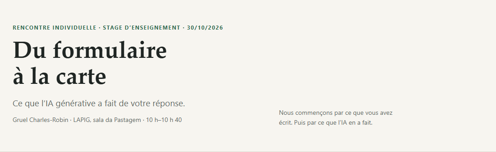

# From form to map — Chindwin, Myanmar

**Presentation and temporal analysis of a transfer test of the Amazon Mining Watch model to Myanmar.**

Individual meeting for the teaching internship · LAPIG/UFG · 30 October 2026.

- **View online:** <https://victorgit10.github.io/gruel-myanmar/>
- **Temporal analysis:** [serie-temporal.html](serie-temporal.html)
- **Repository:** <https://github.com/VictorGit10/gruel-myanmar>
- **Français:** [README.md](README.md) · **Português:** [README.pt.md](README.pt.md)



## What is in this repository

Two self-contained pages, **French by default**, with **PT / EN / FR** buttons:

1. **`index.html` — the presentation.** Five short sections that start from Gruel’s response to the form and show what generative AI did: read the repository, run the model, build the control, present the results, interpret them. The “To go further” link opens the temporal analysis.
2. **`serie-temporal.html` — the temporal analysis.** The same Chindwin block, nine dry seasons (2017–18 to 2025–26), to see whether mining changed after 2021. Maps, chart, table and limits.

Both pages are **offline**: images are embedded in the HTML. They also work on GitHub Pages.

## What the temporal test shows

The study block is ~11 × 11 km around **94.95 E / 24.85 N**, in the Chindwin. The “core” is the mining area already visible in 2019–20; the rest of the block is fields, river and vegetation.

| Dry season | Total > 0.43 | In the core | Outside the core | > 0.75 (total) | Max score |
|---|---:|---:|---:|---:|---:|
| 2017–18 | 31 | 30 | 1 | 19 | 0.986 |
| 2018–19 | 32 | 32 | 0 | 14 | 0.978 |
| 2019–20 | 34 | 34 | 0 | 20 | 0.997 |
| 2020–21 | 48 | 37 | 11 | 17 | 0.991 |
| 2021–22 | 39 | 39 | 0 | 24 | 0.997 |
| 2022–23 | 29 | 29 | 0 | 14 | 0.999 |
| 2023–24 | 63 | 40 | 23 | 20 | 0.984 |
| 2024–25 | 88 | 35 | 53 | 34 | 0.994 |
| 2025–26 | 114 | 29 | 85 | 45 | 0.996 |

**Main reading:**

- In the mining core, the count stays at **29–40 patches** in every season; the average is **32 before 2021** and **34 after**. There is no clear jump after the coup.
- The total rises sharply in 2024–25 and 2025–26, but **53 of 88** and **85 of 114** patches are **outside the core**, in fields to the west that appear bright in the images.
- In the 2021 land-cover map (ESA WorldCover), **37 of 53** and **57 of 85** of these outside-core patches fall on **cropland**. The model flags bare soil; it does not distinguish a prepared field from a mine.
- This test **does not show** that the war increased mining in this block. It also does not prove that there was no increase elsewhere.

The numbers are **counts of 480 m patches** (48 × 48 px, with 50% overlap), not areas, nor an accuracy measure. There are no annual labels to measure precision or recall.

## Repository structure

```
.
├── index.html                 # presentation (FR default, PT/EN/FR)
├── serie-temporal.html        # temporal analysis (FR default, PT/EN/FR)
├── presentation.pdf           # presentation PDF (11 pages)
├── serie-temporelle.pdf       # temporal analysis PDF (6 pages)
├── assets/                    # figures and preview used in the pages and README
├── data/
│   ├── serie_temporal.csv     # table by season
│   ├── serie_temporal.json    # full summaries by season
│   └── landcover_deteccoes.json # WorldCover classes of outside-core detections
├── code/
│   ├── figuras_serie.py       # generates the neutral analysis figures
│   ├── montar_serie.py        # builds serie-temporal.html
│   ├── export_data.py         # exports the CSV/JSON
│   └── analysis/              # series and land-cover scripts
├── docs/
│   └── METHOD.md              # method, data, commands and limits
├── README.md                  # French version
├── README.pt.md               # Portuguese version
├── README.en.md               # this file
├── CITATION.cff
├── LICENSE
└── .gitignore
```

## Data and method

- **Sensor:** Sentinel-2 **L1C** (`COPERNICUS/S2_HARMONIZED`) + **Cloud Score+** (`cs_cdf >= 0.6`), median of the dry season **November–April**.
- **Model:** `48px_v4.10b-18d-20g-21a-22bc-ensemble.h5`, threshold **0.43**; each patch is 48 × 48 px (~480 m). A score of 0.75 is the high-confidence threshold.
- **Area:** an ~11 × 11 km block around **94.95 E / 24.85 N**, in the Chindwin. The official tiler does not crop exactly to the polygon; it produces 4 tiles and 2,116 patches per season.
- **Processing:** Google Earth Engine, 4 tile requests per season, no GPU; ~2–2.5 min per season.
- **Original model:** <https://github.com/earthrise-media/mining-detector> (Earth Genome, MIT licence).
- **Data:** Sentinel-2 / Copernicus; Amazon Mining Watch products, CC BY 4.0.

The full method, commands and limits are in **[docs/METHOD.md](docs/METHOD.md)**.

## Reproduce

This repository does **not** include the model, Earth Engine credentials, or the raw mosaics (too large). To rerun:

1. Clone the original `earthrise-media/mining-detector` repository and follow its RUNBOOK for the Python/TensorFlow environment and Earth Engine authentication.
2. Place the model `48px_v4.10b-18d-20g-21a-22bc-ensemble.h5` in `repo/models/`.
3. Use `code/analysis/run_series.py` to produce the per-season outputs and `code/analysis/analyze_series.py` for the counts and figures.
4. Adjust the paths in the scripts (they were written for the author’s local environment).

The scripts are reproducible documentation, not a ready-to-run package. Main dependencies: Python 3.11, TensorFlow 2.14, `earthengine-api`, `geopandas`, `pandas`, `matplotlib`, `pyproj` and `pypdf`.

## Continue exploring with Codex / ChatGPT

The repository is structured so an assistant can read it. Paste the repository link into your **Codex** or **ChatGPT** and ask, for example:

- “Explain the structure of this repository and how the two pages are built.”
- “Help me add a new test area and rerun the temporal series.”
- “How can I measure precision and recall with annual labels?”
- “Propose a design to test the effect of the war on mining, with comparison areas.”
- “Translate or adapt the presentation for another audience.”

Repository link: <https://github.com/VictorGit10/gruel-myanmar>.

## Limits

- One area, one model, one seasonal window: this is not a representative sample of Myanmar.
- The model was trained on alluvial gold in the Amazon; it responds to bare soil and can confuse fields, roads, burned areas and mines.
- Patch counts are not areas; the 50% overlap and 480 m resolution limit the interpretation.
- There is no annual ground truth in Myanmar; accuracy was not measured.
- The causes of the change (war, gold prices, economic crisis, migration, policy, image availability) are not isolated.

## Credits and licence

- Presentation, text and figures: **Victor** · LAPIG/UFG · 2026.
- Original model and code: **Amazon Mining Watch / Earth Genome**, MIT licence.
- Data: **Sentinel-2 / Copernicus**; Amazon Mining Watch products, CC BY 4.0.
- The text, figures and PDFs in this repository are under **CC BY 4.0**; the code in `code/` is under **MIT**. See [LICENSE](LICENSE).

## Cite

If you reuse this work, see [CITATION.cff](CITATION.cff).
