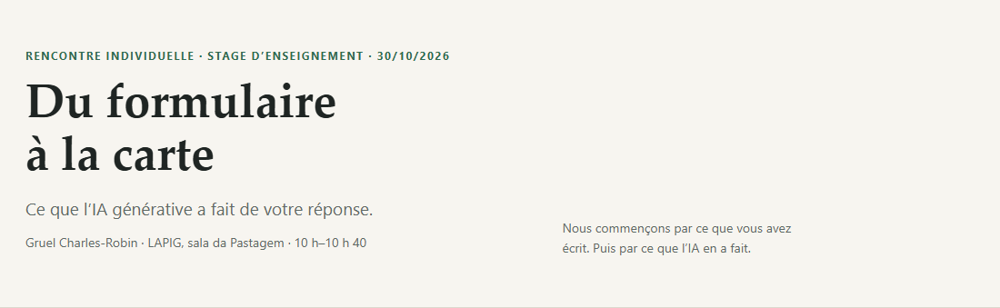

# Du formulaire à la carte — Chindwin, Myanmar

**Présentation et analyse temporelle d’un test de transfert du modèle Amazon Mining Watch au Myanmar.**

Rencontre individuelle du stage d’enseignement · LAPIG/UFG · 30 octobre 2026.

- **Voir en ligne :** <https://victorgit10.github.io/gruel-myanmar/>
- **Analyse temporelle :** [serie-temporal.html](serie-temporal.html)
- **Dépôt :** <https://github.com/VictorGit10/gruel-myanmar>
- **Português :** [README.pt.md](README.pt.md) · **English :** [README.en.md](README.en.md)



## Ce que contient ce dépôt

Deux pages autonomes, en **français par défaut**, avec des boutons **PT / EN / FR** :

1. **`index.html` — la présentation.** Cinq sections courtes qui partent de la réponse de Gruel au formulaire et montrent ce que l’IA générative a fait : lecture du dépôt, exécution du modèle, contrôle, résultats, interprétation. Le lien « Pour aller plus loin » ouvre l’analyse temporelle.
2. **`serie-temporal.html` — l’analyse temporelle.** Le même bloc du Chindwin, neuf saisons sèches (2017–18 à 2025–26), pour voir si l’exploitation a changé après 2021. Cartes, graphique, tableau et limites.

Les deux pages sont **hors ligne** : les images sont embarquées dans le HTML. Elles fonctionnent aussi sur GitHub Pages.

## Ce que montre le test temporel

Le bloc étudié fait ~11 × 11 km autour de **94,95 E / 24,85 N**, dans le Chindwin. Le « noyau » est la zone de garimpo déjà visible en 2019–20 ; le reste du bloc est composé de champs, de rivière et de végétation.

| Saison sèche | Total > 0,43 | Dans le noyau | Hors du noyau | > 0,75 (total) | Score max. |
|---|---:|---:|---:|---:|---:|
| 2017–18 | 31 | 30 | 1 | 19 | 0,986 |
| 2018–19 | 32 | 32 | 0 | 14 | 0,978 |
| 2019–20 | 34 | 34 | 0 | 20 | 0,997 |
| 2020–21 | 48 | 37 | 11 | 17 | 0,991 |
| 2021–22 | 39 | 39 | 0 | 24 | 0,997 |
| 2022–23 | 29 | 29 | 0 | 14 | 0,999 |
| 2023–24 | 63 | 40 | 23 | 20 | 0,984 |
| 2024–25 | 88 | 35 | 53 | 34 | 0,994 |
| 2025–26 | 114 | 29 | 85 | 45 | 0,996 |

**Lecture principale :**

- Dans le noyau de garimpo, le compte reste entre **29 et 40 patches** à chaque saison ; la moyenne est de **32 avant 2021** et **34 après**. Il n’y a pas de saut clair après le coup d’État.
- Le total augmente fortement en 2024–25 et 2025–26, mais **53 des 88** et **85 des 114** patches sont **hors du noyau**, dans des champs à l’ouest qui apparaissent clairs sur les images.
- Sur la carte de couverture 2021 (ESA WorldCover), **37 des 53** et **57 des 85** de ces patches hors noyau tombent sur des **cultures**. Le modèle marque le sol nu ; il ne distingue pas un champ préparé d’une mine.
- Ce test **ne montre pas** que la guerre a augmenté l’exploitation minière dans ce bloc. Il ne prouve pas non plus qu’il n’y a pas eu d’augmentation ailleurs.

Les chiffres sont des **comptages de patches de 480 m** (48 × 48 px, avec 50 % de chevauchement), pas des surfaces, ni une mesure d’exactitude. Il n’y a pas d’étiquettes annuelles pour mesurer précision ou rappel.

## Structure du dépôt

```
.
├── index.html                 # présentation (FR par défaut, PT/EN/FR)
├── serie-temporal.html        # analyse temporelle (FR par défaut, PT/EN/FR)
├── presentation.pdf           # la présentation en PDF (11 pages)
├── serie-temporelle.pdf       # l’analyse temporelle en PDF (6 pages)
├── assets/                    # figures et aperçu utilisés dans les pages et le README
├── data/
│   ├── serie_temporal.csv     # tableau par saison
│   ├── serie_temporal.json    # résumés complets par saison
│   └── landcover_deteccoes.json # classes WorldCover des détections hors noyau
├── code/
│   ├── figuras_serie.py       # génère les figures neutres de l’analyse
│   ├── montar_serie.py        # génère serie-temporal.html
│   ├── export_data.py         # exporte les CSV/JSON
│   └── analysis/              # scripts de la série et de la classification
├── docs/
│   └── METHOD.md              # méthode, données, commandes et limites
├── README.md                  # ce fichier (français)
├── README.pt.md               # version portugaise
├── README.en.md               # version anglaise
├── CITATION.cff
├── LICENSE
└── .gitignore
```

## Données et méthode

- **Capteur :** Sentinel-2 **L1C** (`COPERNICUS/S2_HARMONIZED`) + **Cloud Score+** (`cs_cdf >= 0,6`), médiane de la saison sèche **novembre–avril**.
- **Modèle :** `48px_v4.10b-18d-20g-21a-22bc-ensemble.h5`, seuil **0,43** ; chaque patch fait 48 × 48 px (~480 m). Le score de 0,75 sert de seuil de haute confiance.
- **Zone :** un bloc de ~11 × 11 km autour de **94,95 E / 24,85 N**, dans le Chindwin. Le tiler officiel ne recadre pas exactement le polygone ; il produit 4 tuiles et 2 116 patches par saison.
- **Traitement :** Google Earth Engine, 4 requêtes de tuile par saison, sans GPU ; ~2–2,5 min par saison.
- **Modèle original :** <https://github.com/earthrise-media/mining-detector> (Earth Genome, licence MIT).
- **Données :** Sentinel-2 / Copernicus ; Amazon Mining Watch, CC BY 4.0.

La méthode complète, les commandes et les limites sont dans **[docs/METHOD.md](docs/METHOD.md)**.

## Reproduire

Le dépôt ne contient **ni le modèle**, **ni les credentials Earth Engine**, **ni les mosaïques brutes** (trop volumineuses). Pour refaire l’analyse :

1. Cloner le dépôt original `earthrise-media/mining-detector` et suivre son RUNBOOK pour l’environnement Python/TensorFlow et l’authentification Earth Engine.
2. Placer le modèle `48px_v4.10b-18d-20g-21a-22bc-ensemble.h5` dans `repo/models/`.
3. Utiliser `code/analysis/run_series.py` pour produire les sorties par saison, puis `code/analysis/analyze_series.py` pour les comptages et les figures.
4. Adapter les chemins dans les scripts (ils ont été écrits pour l’environnement local de l’auteur).

Les scripts sont fournis comme documentation reproductible, pas comme un paquet clé en main. Les dépendances principales sont Python 3.11, TensorFlow 2.14, `earthengine-api`, `geopandas`, `pandas`, `matplotlib`, `pyproj` et `pypdf`.

## Continuer l’exploration avec Codex / ChatGPT

Le dépôt est structuré pour qu’un assistant puisse le lire. Vous pouvez coller le lien du dépôt dans votre **Codex** ou **ChatGPT** et demander, par exemple :

- « Explique la structure de ce dépôt et comment les deux pages sont construites. »
- « Aide-moi à ajouter une nouvelle zone de test et à relancer la série temporelle. »
- « Comment mesurer la précision et le rappel avec des étiquettes annuelles ? »
- « Propose un design pour tester l’effet de la guerre sur l’exploitation minière, avec des zones de comparaison. »
- « Traduis ou adapte la présentation pour un autre public. »

Le lien du dépôt : <https://github.com/VictorGit10/gruel-myanmar>.

## Limites

- Une seule zone, un seul modèle, une seule fenêtre saisonnière : ce n’est pas un échantillon représentatif du Myanmar.
- Le modèle a été entraîné sur l’or alluvial de l’Amazonie ; il réagit au sol nu et peut confondre champs, routes, zones brûlées et mines.
- Les comptages de patches ne sont pas des surfaces ; le chevauchement de 50 % et la résolution de 480 m limitent l’interprétation.
- Il n’y a pas de vérité terrain annuelle au Myanmar ; l’exactitude n’a pas été mesurée.
- Les causes de l’évolution (guerre, prix de l’or, crise économique, migration, politique, disponibilité des images) ne sont pas isolées.

## Crédits et licence

- Présentation, textes et figures : **Victor** · LAPIG/UFG · 2026.
- Modèle et code original : **Amazon Mining Watch / Earth Genome**, licence MIT.
- Données : **Sentinel-2 / Copernicus** ; produits Amazon Mining Watch, CC BY 4.0.
- Le texte, les figures et les PDF de ce dépôt sont sous **CC BY 4.0** ; le code de `code/` est sous **MIT**. Voir [LICENSE](LICENSE).

## Citer

Si vous réutilisez ce travail, voir [CITATION.cff](CITATION.cff).
