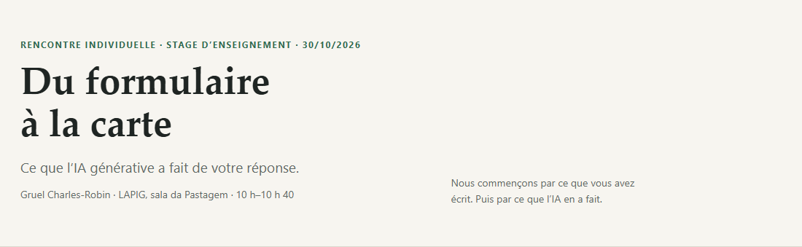

# Do formulário ao mapa — Chindwin, Mianmar

**Apresentação e análise temporal de um teste de transferência do modelo Amazon Mining Watch para Mianmar.**

Encontro individual do estágio docência · LAPIG/UFG · 30 de outubro de 2026.

- **Ver online:** <https://victorgit10.github.io/gruel-myanmar/>
- **Análise temporal:** [serie-temporal.html](serie-temporal.html)
- **Repositório:** <https://github.com/VictorGit10/gruel-myanmar>
- **Français:** [README.md](README.md) · **English:** [README.en.md](README.en.md)



## O que tem neste repositório

Duas páginas autônomas, em **francês por padrão**, com botões **PT / EN / FR**:

1. **`index.html` — a apresentação.** Cinco seções curtas que partem da resposta do Gruel ao formulário e mostram o que a IA generativa fez: leitura do repositório, execução do modelo, controle, resultados e interpretação. O link “Para ir além” abre a análise temporal.
2. **`serie-temporal.html` — a análise temporal.** O mesmo bloco do Chindwin, nove safras secas (2017–18 a 2025–26), para ver se a mineração mudou depois de 2021. Mapas, gráfico, tabela e limites.

As duas páginas são **offline**: as imagens estão embutidas no HTML. Também funcionam no GitHub Pages.

## O que o teste temporal mostra

O bloco estudado tem ~11 × 11 km em torno de **94,95 E / 24,85 N**, no Chindwin. O “núcleo” é a área de garimpo já visível em 2019–20; o resto do bloco é campo, rio e vegetação.

| Safra seca | Total > 0,43 | No núcleo | Fora do núcleo | > 0,75 (total) | Score máx. |
|---|---:|---:|---:|---:|---:|
| 2017–18 | 31 | 30 | 1 | 19 | 0,986 |
| 2018–19 | 32 | 32 | 0 | 14 | 0,978 |
| 2019–20 | 34 | 34 | 0 | 20 | 0,997 |
| 2020–21 | 48 | 37 | 11 | 17 | 0,991 |
| 2021–22 | 39 | 39 | 0 | 24 | 0,997 |
| 2022–23 | 29 | 29 | 0 | 14 | 0,999 |
| 2023–24 | 63 | 40 | 23 | 20 | 0,984 |
| 2024–25 | 88 | 35 | 53 | 34 | 0,994 |
| 2025–26 | 114 | 29 | 85 | 45 | 0,996 |

**Leitura principal:**

- No núcleo de garimpo, a contagem fica em **29–40 patches** em todas as safras; a média é **32 antes de 2021** e **34 depois**. Não há salto claro depois do golpe.
- O total sobe muito em 2024–25 e 2025–26, mas **53 dos 88** e **85 dos 114** patches estão **fora do núcleo**, em campos a oeste que ficam claros nas imagens.
- No mapa de cobertura de 2021 (ESA WorldCover), **37 dos 53** e **57 dos 85** desses patches fora do núcleo caem em **agricultura**. O modelo marca solo exposto; ele não distingue campo preparado de mina.
- Este teste **não mostra** que a guerra aumentou a mineração neste bloco. Também não prova que não houve aumento em outros lugares.

Os números são **contagens de patches de 480 m** (48 × 48 px, com 50% de sobreposição), não áreas, nem uma medida de acurácia. Não há rótulos anuais para medir precisão ou revocação.

## Estrutura

```
.
├── index.html                 # apresentação (FR padrão, PT/EN/FR)
├── serie-temporal.html        # análise temporal (FR padrão, PT/EN/FR)
├── presentation.pdf           # apresentação em PDF (11 páginas)
├── serie-temporelle.pdf       # análise temporal em PDF (6 páginas)
├── assets/                    # figuras e prévia usadas nas páginas e no README
├── data/
│   ├── serie_temporal.csv     # tabela por safra
│   ├── serie_temporal.json    # resumos completos por safra
│   └── landcover_deteccoes.json # classes WorldCover das detecções fora do núcleo
├── code/
│   ├── figuras_serie.py       # gera as figuras neutras da análise
│   ├── montar_serie.py        # gera serie-temporal.html
│   ├── export_data.py         # exporta os CSV/JSON
│   └── analysis/              # scripts da série e da classificação
├── docs/
│   └── METHOD.md              # método, dados, comandos e limites
├── README.md                  # versão em francês
├── README.pt.md               # este arquivo
├── README.en.md               # versão em inglês
├── CITATION.cff
├── LICENSE
└── .gitignore
```

## Dados e método

- **Sensor:** Sentinel-2 **L1C** (`COPERNICUS/S2_HARMONIZED`) + **Cloud Score+** (`cs_cdf >= 0,6`), mediana da safra seca **novembro–abril**.
- **Modelo:** `48px_v4.10b-18d-20g-21a-22bc-ensemble.h5`, limiar **0,43**; cada patch tem 48 × 48 px (~480 m). O score 0,75 é o limiar de alta confiança.
- **Área:** um bloco de ~11 × 11 km em torno de **94,95 E / 24,85 N**, no Chindwin. O tiler oficial não recorta exatamente o polígono; ele produz 4 tiles e 2.116 patches por safra.
- **Processamento:** Google Earth Engine, 4 requisições de tile por safra, sem GPU; ~2–2,5 min por safra.
- **Modelo original:** <https://github.com/earthrise-media/mining-detector> (Earth Genome, licença MIT).
- **Dados:** Sentinel-2 / Copernicus; Amazon Mining Watch, CC BY 4.0.

O método completo, os comandos e os limites estão em **[docs/METHOD.md](docs/METHOD.md)**.

## Reproduzir

O repositório **não contém o modelo**, **nem as credenciais do Earth Engine**, **nem os mosaicos brutos** (grandes demais). Para refazer:

1. Clonar o repositório original `earthrise-media/mining-detector` e seguir o RUNBOOK para o ambiente Python/TensorFlow e a autenticação no Earth Engine.
2. Colocar o modelo `48px_v4.10b-18d-20g-21a-22bc-ensemble.h5` em `repo/models/`.
3. Usar `code/analysis/run_series.py` para gerar as saídas por safra e `code/analysis/analyze_series.py` para as contagens e figuras.
4. Ajustar os caminhos nos scripts (eles foram escritos para o ambiente local do autor).

Os scripts são documentação reprodutível, não um pacote pronto. As dependências principais são Python 3.11, TensorFlow 2.14, `earthengine-api`, `geopandas`, `pandas`, `matplotlib`, `pyproj` e `pypdf`.

## Continuar a exploração com Codex / ChatGPT

O repositório foi organizado para que um assistente consiga lê-lo. Você pode colar o link no seu **Codex** ou **ChatGPT** e pedir, por exemplo:

- “Explique a estrutura deste repositório e como as duas páginas são construídas.”
- “Me ajude a adicionar uma nova área de teste e rodar a série temporal.”
- “Como medir precisão e revocação com rótulos anuais?”
- “Proponha um desenho para testar o efeito da guerra na mineração, com áreas de comparação.”
- “Traduza ou adapte a apresentação para outro público.”

O link do repositório: <https://github.com/VictorGit10/gruel-myanmar>.

## Limites

- Uma só área, um só modelo, uma só janela sazonal: não é uma amostra representativa de Mianmar.
- O modelo foi treinado em ouro aluvial da Amazônia; ele reage a solo exposto e pode confundir campos, estradas, áreas queimadas e minas.
- Contagens de patches não são áreas; a sobreposição de 50% e a resolução de 480 m limitam a interpretação.
- Não há verdade terrestre anual em Mianmar; a acurácia não foi medida.
- As causas da evolução (guerra, preço do ouro, crise econômica, migração, política, disponibilidade de imagens) não são isoladas.

## Créditos e licença

- Apresentação, textos e figuras: **Victor** · LAPIG/UFG · 2026.
- Modelo e código original: **Amazon Mining Watch / Earth Genome**, licença MIT.
- Dados: **Sentinel-2 / Copernicus**; produtos Amazon Mining Watch, CC BY 4.0.
- O texto, as figuras e os PDFs deste repositório estão sob **CC BY 4.0**; o código em `code/` está sob **MIT**. Veja [LICENSE](LICENSE).

## Citar

Se você reutilizar este trabalho, veja [CITATION.cff](CITATION.cff).
